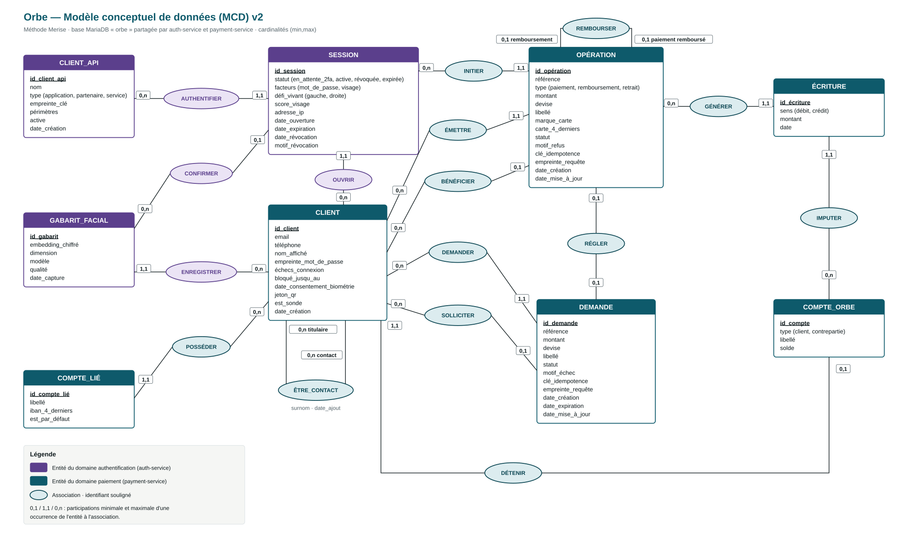

# Orbe — Modèle conceptuel de données (MCD) v2

> Méthode Merise. Une seule base MariaDB `orbe`, **partagée par auth-service et payment-service**,
> chacun avec un compte à moindre privilège ; le moteur de remédiation la lit en lecture seule.
> Voir aussi CADRAGE §4.2 (authentification), §4.3 (paiements) et §5 (modèle de données).
>
> **Statut** : appliqué au schéma (`infra/mariadb/init/01-schema.sql`), à auth-service et à payment-service.

## 1. Règles de gestion

### Authentification (auth-service)

| # | Règle |
|---|---|
| RG-01 | Un client est identifié par un identifiant ; son email et son téléphone sont uniques. |
| RG-02 | La connexion exige **deux facteurs** : le mot de passe (stocké haché en argon2id) puis une **passkey** (WebAuthn) déverrouillée par la biométrie de l'appareil (Face ID, Windows Hello). Aucune donnée biométrique n'est transmise ni stockée : le serveur ne conserve que la clé publique de la passkey. |
| RG-03 | Un client enregistre 0 à n passkeys (une par appareil) ; une passkey appartient à un seul client. |
| RG-04 | Après 5 échecs de mot de passe, le compte est bloqué 10 minutes. Chaque tentative est tracée dans les journaux (Loki / SOC), pas en base. |
| RG-05 | Une session est ouverte par un seul client, à travers une seule application cliente (CLIENT_API). Elle passe par l'état `en_attente_2fa` tant que la passkey n'a pas été vérifiée, puis devient `active`. Elle peut être **révoquée** (compromission, déconnexion) avant son expiration. |
| RG-06 | Une session active est confirmée par au plus une passkey. Exception documentée : les sessions de la **sonde** (CLIENT_API de type `service`) sont ouvertes sans passkey et ne peuvent agir que sur les comptes de la sonde. |
| RG-07 | Une application cliente (appli Orbe, partenaire, sonde) est identifiée par une clé d'API stockée sous forme d'empreinte SHA-256 et limitée à des périmètres. |

### Paiements (payment-service)

| # | Règle |
|---|---|
| RG-08 | Toute opération (paiement, remboursement, retrait) est **initiée dans une session active et non révoquée**, et émise par le client de cette session. |
| RG-09 | Un paiement est réglé par **carte de test** et crédite le compte Orbe du bénéficiaire. 0 < montant ≤ **500 €** par opération, frais nuls. Pas de paiement à soi-même. |
| RG-10 | Une opération bénéficie à au plus un client : le bénéficiaire d'un paiement, le payeur d'origine d'un remboursement ; un retrait n'a pas de bénéficiaire. |
| RG-11 | Un envoi ne s'annule pas : un remboursement est une **nouvelle opération** liée au paiement d'origine. Un paiement est remboursé au plus une fois, par son bénéficiaire. |
| RG-12 | Une opération **autorisée ou effectuée génère exactement deux écritures** de même montant : un débit et un crédit. Une opération refusée ou échouée n'en génère aucune (« l'argent n'a pas bougé »). |
| RG-13 | Chaque écriture est imputée à un seul compte Orbe. Le **solde d'un compte** est la somme de ses crédits moins la somme de ses débits. |
| RG-14 | Chaque client détient exactement un compte Orbe (son solde). Les **comptes de contrepartie** (« Encaissements carte », « Retraits ») représentent l'extérieur d'Orbe et n'appartiennent à aucun client : sans eux, l'argent qui entre par carte ou sort vers la banque n'aurait pas d'écriture en face. |
| RG-15 | Un client possède 0 à n comptes liés (comptes bancaires fictifs qui reçoivent les retraits), dont **un par défaut** ; un retrait est versé sur le compte choisi, sinon sur le compte par défaut. |
| RG-16 | Une demande d'argent est émise par un client, adressée à au plus un autre client (aucun si le contact est inconnu) et réglée par au plus un paiement. Statuts : en attente, payée, refusée, annulée, expirée (7 jours). |
| RG-17 | Les opérations de la sonde passent par les comptes de la sonde (`est_sonde`) et sont exclues des vues et statistiques métier. |
| RG-18 | Un client ajoute 0 à n **contacts**, qui sont obligatoirement des clients Orbe, avec un surnom facultatif ; on ne peut pas s'ajouter soi-même ni ajouter deux fois le même contact. Envoyer de l'argent reste possible à un client inscrit hors contacts (par email, téléphone ou QR). |

## 2. Biométrie faciale : ce qui est stocké (et ce qui ne l'est pas)

| Étape | Où | Ce qui se passe |
|---|---|---|
| Enregistrement du visage | **Téléphone / PC** (réglages Face ID, Windows Hello) | Fait une fois par l'utilisateur, en dehors d'Orbe. Le gabarit du visage ne quitte jamais l'appareil. |
| Inscription d'une passkey sur Orbe | Appareil → auth-service | L'appareil crée une paire de clés ; la **clé privée** reste dans sa puce sécurisée, verrouillée par le visage. Orbe stocke **uniquement la clé publique** (entité PASSKEY). |
| Connexion | Appareil ↔ auth-service | Orbe envoie un défi ; l'appareil affiche Face ID, **reconnaît le visage lui-même**, puis signe le défi. Orbe vérifie la signature avec la clé publique. |

Orbe n'enregistre donc **aucune image ni gabarit biométrique** : c'est l'appareil qui fait la reconnaissance faciale, Orbe en reçoit la preuve cryptographique. Alternative écartée : stocker une photo ou un gabarit côté serveur (donnée sensible RGPD art. 9, fraude par simple photo sans détection du vivant, modèle lourd sur le PC Hôte).

## 3. Entités

| Entité | Domaine | Rôle |
|---|---|---|
| CLIENT | commun | Utilisateur d'Orbe : identité, mot de passe, blocage, jeton du QR « Recevoir ». |
| PASSKEY | auth | Identifiant WebAuthn d'un appareil : clé publique et compteur de signatures (détection de clonage). |
| SESSION | auth | Session ouverte après authentification ; porte les facteurs utilisés et l'état de révocation. Son identifiant est le `jti` du JWT. |
| CLIENT_API | auth | Application qui ouvre les sessions : appli Orbe, partenaire, sonde. Remplace la table `api_keys` de la v1. |
| OPÉRATION | paiement | Paiement, remboursement ou retrait ; référence publique `tx_` + 8 caractères hexadécimaux. |
| ÉCRITURE | paiement | Mouvement au débit ou au crédit d'un compte Orbe. Base du contrôle de cohérence. |
| COMPTE_ORBE | paiement | Compte de la comptabilité Orbe : compte d'un client, ou compte de **contrepartie** qui représente l'extérieur (réseau carte, banques). Porte le solde. |
| COMPTE_LIÉ | paiement | Compte bancaire fictif du client qui reçoit les retraits ; seuls les 4 derniers caractères de l'IBAN sont conservés. Un compte est marqué par défaut. |
| DEMANDE | paiement | Demande d'argent ; référence `rq_` + 8 caractères hexadécimaux. |

## 4. Associations et cardinalités

| Association | Entités | Cardinalités | Lecture |
|---|---|---|---|
| ENREGISTRER | PASSKEY — CLIENT | 1,1 — 0,n | Une passkey appartient à 1 client ; un client a 0 à n passkeys (RG-03). |
| OUVRIR | SESSION — CLIENT | 1,1 — 0,n | Une session est ouverte par 1 client ; un client ouvre 0 à n sessions (RG-05). |
| AUTHENTIFIER | CLIENT_API — SESSION | 0,n — 1,1 | Une application ouvre 0 à n sessions ; une session passe par 1 application (RG-05). |
| CONFIRMER | PASSKEY — SESSION | 0,n — 0,1 | Une passkey confirme 0 à n sessions ; une session est confirmée par 0 ou 1 passkey (RG-06). |
| INITIER | SESSION — OPÉRATION | 0,n — 1,1 | Une session initie 0 à n opérations ; une opération vient de 1 session (RG-08). |
| ÉMETTRE | CLIENT — OPÉRATION | 0,n — 1,1 | Un client émet 0 à n opérations ; une opération a 1 émetteur (RG-08). |
| BÉNÉFICIER | CLIENT — OPÉRATION | 0,n — 0,1 | Une opération a 0 ou 1 bénéficiaire (RG-10). |
| REMBOURSER (réflexive) | OPÉRATION — OPÉRATION | 0,1 — 0,1 | Un remboursement porte sur 1 paiement au plus ; un paiement est remboursé au plus 1 fois (RG-11). |
| GÉNÉRER | OPÉRATION — ÉCRITURE | 0,n — 1,1 | Une opération génère 0 ou 2 écritures ; une écriture vient de 1 opération (RG-12). |
| IMPUTER | ÉCRITURE — COMPTE_ORBE | 1,1 — 0,n | Une écriture est imputée à 1 compte ; un compte reçoit 0 à n écritures (RG-13). |
| DÉTENIR | CLIENT — COMPTE_ORBE | 1,1 — 0,1 | Un client détient 1 compte Orbe ; un compte appartient à 0 (contrepartie) ou 1 client (RG-14). |
| POSSÉDER | COMPTE_LIÉ — CLIENT | 1,1 — 0,n | Un compte lié appartient à 1 client ; un client a 0 à n comptes liés (RG-15). |
| ÊTRE_CONTACT (réflexive, porteuse de *surnom*, *date_ajout*) | CLIENT — CLIENT | 0,n titulaire — 0,n contact | Un client a 0 à n contacts ; un client figure dans les contacts de 0 à n autres clients (RG-18). |
| DEMANDER | CLIENT — DEMANDE | 0,n — 1,1 | Une demande a 1 demandeur (RG-16). |
| SOLLICITER | CLIENT — DEMANDE | 0,n — 0,1 | Une demande sollicite 0 ou 1 payeur (RG-16). |
| RÉGLER | OPÉRATION — DEMANDE | 0,1 — 0,1 | Une demande est réglée par 0 ou 1 paiement, et inversement (RG-16). |

## 5. Écritures générées par type d'opération

| Opération | Débit | Crédit |
|---|---|---|
| Paiement autorisé | contrepartie « Encaissements carte » | compte Orbe du bénéficiaire |
| Remboursement | compte Orbe du bénéficiaire du paiement | contrepartie « Encaissements carte » |
| Retrait | compte Orbe du client | contrepartie « Retraits » |
| Paiement refusé ou échoué | — | — |

## 6. Contraintes d'intégrité non exprimables dans le diagramme

| Contrainte | Garantie par |
|---|---|
| **Équilibre** : pour chaque opération, Σ débits = Σ crédits | payment-service (écritures insérées dans la même transaction SQL que l'opération) ; contrôle de cohérence de la remédiation |
| **Solde** : solde d'un compte = Σ crédits − Σ débits de ses écritures | idem ; le solde est conservé dans COMPTE_ORBE comme valeur dérivée, recalculable |
| Solde d'un compte **client** ≥ 0 (les comptes de contrepartie peuvent être négatifs) | contrôle applicatif + contrôle de cohérence |
| Montant > 0 et ≤ 500 € | `CHECK` + payment-service |
| Le client de la session qui initie une opération en est l'émetteur | payment-service (lecture du `jti` et du `sub` du JWT) |
| Une session `révoquée` ou `expirée` n'initie plus d'opération | payment-service : liste de révocation consultée avec un cache court, pour ne pas consommer une connexion du pool à chaque paiement |
| Le compteur d'une passkey ne fait qu'augmenter (sinon : passkey clonée, session refusée) | auth-service (vérification WebAuthn) |
| Exactement un compte lié par défaut par client (s'il en a au moins un) | payment-service (bascule atomique du compte par défaut) |
| Pas de contact vers soi-même, pas de doublon | `CHECK (owner_id <> contact_id)`, `PRIMARY KEY (owner_id, contact_id)` |
| Clé d'idempotence unique par client émetteur | `UNIQUE (payer_id, idempotency_key)`, `UNIQUE (requester_id, idempotency_key)` |
| Les sessions de la sonde n'agissent que sur les comptes de la sonde | payment-service |

## 7. Passage au modèle logique (MLD)

Clés primaires soulignées, clés étrangères précédées de `#`.

| Table | Colonnes | Associations traduites |
|---|---|---|
| **clients** | <u>id</u>, email, phone, display_name, password_hash, failed_logins, locked_until, qr_token, is_probe, created_at | — (le solde passe dans `ledger_accounts`) |
| **passkeys** | <u>id</u>, credential_id *unique*, public_key, sign_count, device_name, created_at, last_used_at, #client_id | ENREGISTRER |
| **client_apis** | <u>id</u>, name, type, key_hash *unique, nullable*, scopes, active, created_at | remplace `api_keys` |
| **sessions** | <u>id</u> (= `jti`), status, factors, webauthn_challenge, ip_address, opened_at, expires_at, revoked_at, revocation_reason, #client_id, #client_api_id, #passkey_id *nullable* | OUVRIR, AUTHENTIFIER, CONFIRMER |
| **ledger_accounts** | <u>id</u>, type, label, balance_cents, #client_id *unique, nullable* | DÉTENIR |
| **payout_accounts** | <u>id</u>, label, iban_last4, is_default, #client_id | POSSÉDER |
| **contacts** | <u>#owner_id, #contact_id</u>, alias, added_at | ÊTRE_CONTACT (association n,n → table) |
| **transactions** | <u>id</u>, reference, type, amount_cents, currency, description, card_brand, card_last4, status, decline_reason, idempotency_key, request_hash, created_at, updated_at, #session_id, #payer_id, #recipient_id *nullable*, #parent_id *unique, nullable* | INITIER, ÉMETTRE, BÉNÉFICIER, REMBOURSER |
| **ledger_entries** | <u>id</u>, direction (`debit`, `credit`), amount_cents, created_at, #transaction_id, #account_id | GÉNÉRER, IMPUTER |
| **payment_requests** | <u>id</u>, reference, amount_cents, currency, description, status, failure_reason, idempotency_key, request_hash, created_at, expires_at, updated_at, #requester_id, #payer_id *nullable*, #transaction_id *unique, nullable* | DEMANDER, SOLLICITER, RÉGLER |

### Droits des comptes MariaDB (cible)

| Compte | Droits |
|---|---|
| `auth_svc` | `clients` (lecture, `UPDATE (failed_logins, locked_until)`), `passkeys`, `sessions` (lecture/écriture), `client_apis` (lecture) |
| `payment_svc` | `clients` (lecture, `UPDATE (qr_token)`), `sessions` (lecture : révocation), `ledger_accounts` (lecture, `UPDATE (balance_cents)`), `ledger_entries` (lecture, insertion), `transactions`, `payment_requests`, `payout_accounts` et `contacts` (lecture, écriture) |
| `remediation_ro` | lecture de `transactions`, `ledger_entries`, `ledger_accounts` (contrôle de cohérence) |

## 8. Évolutions par rapport à la v1

| v1 | v2 |
|---|---|
| Solde stocké dans `clients`, invariant recalculé à partir des opérations | Comptabilité en partie double : `ledger_accounts` + `ledger_entries` |
| JWT sans état, révocation par rotation de la clé | Table `sessions` : révocation ciblée (scénario SC-02) |
| Mot de passe seul | Mot de passe + passkey biométrique (WebAuthn) |
| `api_keys` (partenaires) | `client_apis` (application, partenaire, service) |
| Plafond 5 000 € | Plafond 500 € |
| Un seul compte lié | 0 à n comptes liés, dont un par défaut |
| — | Contacts (association réflexive sur CLIENT) |
