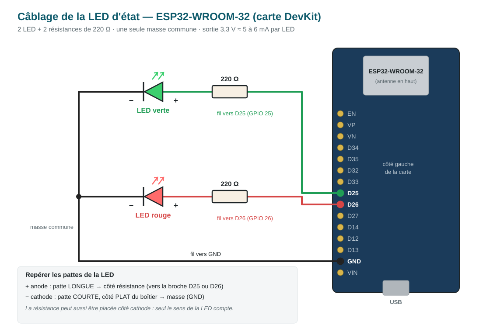

# led-controller — LED d'état du back-office

Programme de la carte qui affiche l'état de la connexion au back-office (consigne
additionnelle 1, `docs/mcd.md` §9.1). Croquis **Arduino IDE** : `led_controller/led_controller.ino`.

| État demandé par auth-service | LED |
|---|---|
| repos | éteinte |
| visage reconnu, en attente du mot de passe | verte clignotante (60 s au plus) |
| mot de passe correct | verte fixe 30 s, puis éteinte |
| mot de passe faux | rouge clignotante × 10, puis éteinte |
| visage non reconnu | rouge fixe 30 s, puis éteinte |

## Câblage



Carte ESP32 38 broches : tout se branche sur le côté qui commence par **3V3**.

| Broche | Vers |
|---|---|
| P25 (GPIO 25) | résistance 220 Ω → patte longue (+) de la LED **verte** |
| P26 (GPIO 26) | résistance 220 Ω → patte longue (+) de la LED **rouge** |
| GND (entre P12 et P13) | pattes courtes (−) des deux LED |

GPIO 25 et 26 sont des sorties sans rôle au démarrage de la carte (contrairement à
GPIO 0, 2, 5, 12, 15). Sur un ESP8266 (NodeMCU) : D1 pour le vert, D2 pour le rouge.

## Préparer Arduino IDE (une seule fois)

1. **Carte** : Fichier → Préférences → « URL de gestionnaire de cartes supplémentaires » :
   `https://espressif.github.io/arduino-esp32/package_esp32_index.json`
   puis Outils → Carte → Gestionnaire de cartes → installer **esp32 by Espressif Systems**.
2. **Bibliothèques** : Croquis → Inclure une bibliothèque → Gérer les bibliothèques →
   installer **ArduinoJson** (Benoit Blanchon, version 7).
3. **Pilote USB** : si Windows ne voit pas la carte, installer le pilote du convertisseur USB
   (CP210x ou CH340, inscrit sur la petite puce près du port USB).

## Configurer

1. Dans le dossier `led_controller`, copier `arduino_secrets.example.h` en
   `arduino_secrets.h` (ignoré par Git), puis le rouvrir dans Arduino IDE.
2. Y mettre le nom et le mot de passe du hotspot `RESILIENCE-G<n>`, et dans
   `LED_DEVICE_KEY` le contenu de `secrets/led_device_key`.
3. Le hotspot Windows doit émettre en **2,4 GHz** : l'ESP ne voit pas le 5 GHz
   (Paramètres → Point d'accès mobile → Bande réseau).

## Téléverser

1. Ouvrir `led_controller/led_controller.ino`.
2. Outils → Carte → **ESP32 Dev Module** ; Outils → Port → le port COM de la carte.
3. Bouton **Téléverser** (flèche). Si l'envoi reste bloqué sur « Connecting… », maintenir
   le bouton **BOOT** de la carte jusqu'au début de l'écriture.
4. Outils → **Moniteur série**, à **115200** bauds, fin de ligne « Nouvelle ligne ».

## Fonctionnement

La carte interroge toutes les 300 ms `GET https://192.168.137.1/devices/led` avec l'en-tête
`X-Device-Key`. Le WAF ne laisse passer vers auth-service que cette route, en lecture
(`infra/waf/vhosts.conf`). Réponse d'auth-service (`services/auth-service/app/led.py`) :

```json
{"state": "green_blink", "seq": 12, "remaining_ms": null, "blinks": null, "blink_period_ms": 500}
```

`seq` change à chaque nouvel état : la carte lance alors le motif et le joue elle-même.
Un motif limité dans le temps se termine même si le réseau tombe ; un motif sans fin
(vert clignotant) s'éteint après 10 s sans réponse du serveur.

**Limite connue** : la connexion est chiffrée mais le certificat du WAF n'est pas vérifié
(certificat auto-signé, carte jointe par adresse IP). Sur le hotspot, un poste malveillant
pourrait se faire passer pour le serveur et lire la clé d'appareil ; la clé ne donne accès
qu'à l'état de la LED.

## Tester

**Sans serveur** : dans le moniteur série, taper `green_blink`, `green_fixed`, `red_fixed`,
`red_blink`, `off` ou `status`.

**Avec le serveur** :

1. Activer le hotspot Windows (2,4 GHz) et démarrer les conteneurs (`infra/`).
2. Depuis le PC Hôte, vérifier la route (PowerShell) :
   ```powershell
   curl.exe -k https://127.0.0.1/devices/led -H "X-Device-Key: $(Get-Content secrets\led_device_key)"
   ```
   Réponse attendue : `{"state":"off","seq":0,...}`.
3. Dans le moniteur série de la carte, `status` doit afficher `wifi=ok` et `http=200`.
4. Se connecter au back-office : la LED suit les étapes du tableau en haut de ce fichier.
