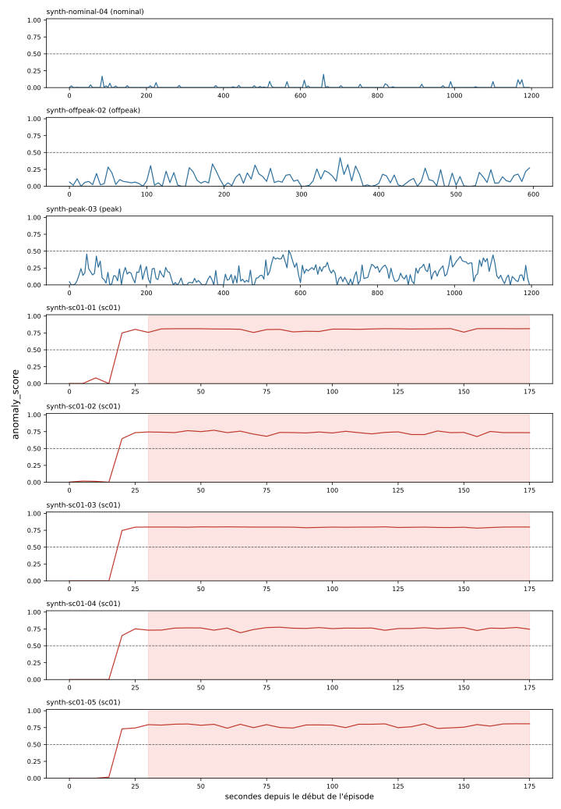

# Évaluation du modèle payment-service

> ⚠ **Données fictives** (`ml/synth.py`) : résultats de mise au point, pas une mesure sur la plateforme.

Modèle : `model-payment.joblib` · 11 variables · règle `score > seuil` pendant 10 s (3 évaluations à 5 s)

Pire score soutenu en trafic normal : **0.384** → seuil retenu **0.50** (marge 0.05)

## Seuil retenu

|   threshold |   false_alert_episodes |   normal_episodes |   detected_attacks |   attack_episodes |   median_delay_s |   max_delay_s |
|------------:|-----------------------:|------------------:|-------------------:|------------------:|-----------------:|--------------:|
|         0.5 |                      0 |                 3 |                  5 |                 5 |               10 |            10 |

## Par épisode

| episode          | label   |   duration_s |   max_score | alert   |   alert_time_pct |   delay_s |
|:-----------------|:--------|-------------:|------------:|:--------|-----------------:|----------:|
| synth-nominal-04 | nominal |         1200 |       0.195 | False   |              0   |       nan |
| synth-offpeak-02 | offpeak |          600 |       0.424 | False   |              0   |       nan |
| synth-peak-03    | peak    |         1200 |       0.513 | False   |              0   |       nan |
| synth-sc01-01    | sc01    |          180 |       0.815 | True    |             83.3 |        10 |
| synth-sc01-02    | sc01    |          180 |       0.77  | True    |             83.3 |        10 |
| synth-sc01-03    | sc01    |          180 |       0.801 | True    |             83.3 |        10 |
| synth-sc01-04    | sc01    |          180 |       0.776 | True    |             83.3 |        10 |
| synth-sc01-05    | sc01    |          180 |       0.807 | True    |             83.3 |        10 |

## Balayage des seuils

|   threshold |   false_alert_episodes |   normal_episodes |   detected_attacks |   attack_episodes |   median_delay_s |   max_delay_s |
|------------:|-----------------------:|------------------:|-------------------:|------------------:|-----------------:|--------------:|
|        0.5  |                      0 |                 3 |                  5 |                 5 |             10   |            10 |
|        0.55 |                      0 |                 3 |                  5 |                 5 |             10   |            10 |
|        0.6  |                      0 |                 3 |                  5 |                 5 |             10   |            10 |
|        0.65 |                      0 |                 3 |                  5 |                 5 |             10   |            15 |
|        0.7  |                      0 |                 3 |                  5 |                 5 |             10   |            15 |
|        0.75 |                      0 |                 3 |                  4 |                 5 |             17.5 |            30 |
|        0.8  |                      0 |                 3 |                  2 |                 5 |             90   |           155 |
|        0.85 |                      0 |                 3 |                  0 |                 5 |            nan   |           nan |
|        0.9  |                      0 |                 3 |                  0 |                 5 |            nan   |           nan |
|        0.95 |                      0 |                 3 |                  0 |                 5 |            nan   |           nan |

